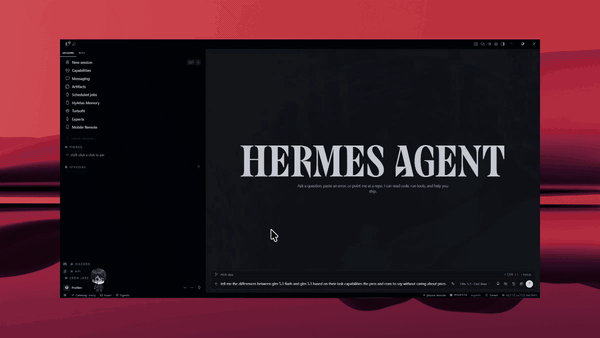

# Hermes Enhance Prompt


Sparkle beside Send on [Hermes Desktop](https://hermes-agent.nousresearch.com). Click it to rewrite the composer draft. It does **not** send the message.

- Messy draft → sparkle → numbered agent brief
- Score on the button: `40→72` (before → after)
- Click the discard icon to revert (replaces the draft, does not append)
- Click while spinning to cancel the wait
- Ctrl/Cmd+K → **Enhance prompt**

Uses your **current Desktop model** via a hidden Hermes session. Same language as the original. Does not invent tech you did not name. Does not answer the question — it expands it.

## Demo



Messy draft → sparkle → numbered ask. It does not send.

Higher-quality MP4: [assets/demo-enhance-prompt.mp4](assets/demo-enhance-prompt.mp4)

---

## What the rewrite looks like

**Short / already-clear input** → tight 1–3 numbered steps.

**Substantive input** → a production-grade brief, only the sections that apply:

1. Goal
2. Role & context
3. Scope (IN / OUT)
4. Requirements (3–7 numbered, each one action)
5. Deliverable
6. Quality gates
7. Anti-patterns

---

## Install

```
hermes plugins install tuancookiez-hub/hermes-enhance-prompt
hermes plugins enable enhance-prompt
```

One package covers both halves. The sparkle loads from `desktop/plugin.js` inside the install. Reload desktop plugins (Ctrl/Cmd+K → Reload desktop plugins) if the button is missing.

## Which model it uses

Default is **auto**: the model of the chat you are in.

To pin a different model:

1. Hermes Desktop → Settings → Plugins → Enhance Prompt
2. Set **Enhance model** to a model id (the same string the model pill shows), or back to `auto`

The sparkle tooltip shows which one it will use. The id has to be one your current provider can serve. `/enhance` and the `enhance_prompt` tool read the same setting. A pinned model needs the install-time model-override consent; `auto` does not.

## Disclosure

Each sparkle click opens a hidden Hermes session on your gateway and runs one rewrite. A second hidden session may score the result. The plugin sends nothing to a third party and does not send the composer message. No credentials, no telemetry, no self-update. Drafts under 8 characters are ignored.

## License

MIT — see `LICENSE`.
